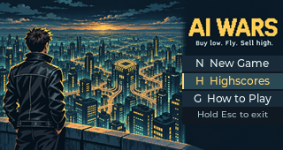
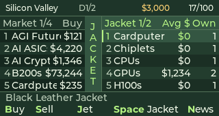

# AI Wars

[](LICENSE)
[](CMakeLists.txt)

**AI Wars** is an offline, single-player trading strategy game for the M5Stack CardputerZero. You start in Silicon Valley with $3,000 and a black leather jacket. Stock it with AI hardware, data, and speculative assets, then fly between eight cities and see how much you can make in 30 in-game days.

[Releases](https://github.com/randombits0110/cardputer-zero-ai-warz/releases) · [How to play](#how-to-play) · [Build from source](#building-from-source)

## Features

- **Eight markets, one jacket.** Buy low and sell high. Every lot takes one jacket slot. Your jacket tracks what you own and the average price you paid.
- **Headlines and surprises.** Breaking news moves local prices. After a flight, you might find abandoned cargo, get an offer to expand your jacket, or lose stock to a surprise encounter.
- **Local saves and high scores.** Continue a saved run, compete for a spot on the top-ten leaderboard, and share a score by scanning its QR code.

## Screenshots

| Main menu | Market and jacket in a short simulator test run |
| :---: | :---: |
|  |  |

## Requirements

- **CardputerZero** — M5Stack CardputerZero running its ARM64 Linux system with APPLaunch. The game uses the built-in keyboard and 320 × 170 display. [Device documentation](https://docs.m5stack.com/en/CardputerZero)

## Installation

Check [GitHub Releases](https://github.com/randombits0110/cardputer-zero-ai-warz/releases) for a prebuilt CardputerZero package, or see [Building from source](#building-from-source). Locally built packages are written to `dist/`.

### Per-user installation

Copy the ARM64 `.deb` and `install-ai-wars-user.sh` to the device. Run the installer as your regular CardputerZero user, using the downloaded package filename.

```sh
sh install-ai-wars-user.sh install ./ai-wars_1.0.0-rev2_arm64.deb
~/.local/bin/ai-wars
```

The installer registers a desktop shortcut with an **Uninstall AI Wars** action for XDG-compatible desktops. Stock APPLaunch reads its system application directory, so use the terminal command for a per-user install. If APPLaunch is active and using the display, you can stop the launcher from SSH with `systemctl --user stop APPLaunch.service`, run the game, then restart it with `systemctl --user start APPLaunch.service`.

The game uses the firmware's shared libraries and the account's existing display and keyboard permissions. To uninstall, run `~/.local/bin/ai-wars-uninstall`. Saves, highscores, and screenshots remain in the player's existing directories.

### System-wide installation

Install the ARM64 package through APT to register **AI Wars** in stock APPLaunch.

```sh
sudo apt install ./ai-wars_1.0.0-rev2_arm64.deb
```

## How to Play

1. Press any key at the title screen. Choose **New Game** (`N`) and enter a player name, or press `C` to resume a saved run.
2. Buy goods in lots and use the jacket's **Avg $** column to judge whether a sale makes a profit. Trading takes no in-game time.
3. Press `J` to fly to a different city. Each flight costs one day and brings fresh quotes. Read the headlines and follow the prompts when an encounter appears.
4. On day 30, sell what you can, then press `E` to review your score and Enter to settle. The default final buyout values unsold cargo at 70% of local prices.

| Action | Controls |
| --- | --- |
| Select a market row or change pages | Up/Down or `F`/`X` to move, `1`–`5` to pick a row, Left/Right or `Z`/`C` to page |
| Toggle the jacket, sort, or reread news | Space or `I` for the jacket, Tab to sort, `N` for news |
| Buy or sell | `B` to buy, `S` to sell. Type a quantity or press `M` for Max, then Enter to confirm. |
| Pick a destination in Jet | `1`–`8` to fly directly, or select a city and press Enter. Enter or Space skips the flight animation. |
| Go back or quit | Tap Esc to go back. Hold Esc to quit. |

Press `G` at the main menu for the in-game guide or `H` for **Highscores**. Select a score and press Enter to show its QR code. Print Screen saves a PNG of the game display.

Press `S` at the main menu to turn sound off or back on. AI Wars remembers this setting when you reopen it.

## Building from Source

Install Git, CMake 3.31 or later, Ninja, and a C++17 toolchain. The first configure downloads LVGL and may fetch other dependencies.

```sh
git clone https://github.com/randombits0110/cardputer-zero-ai-warz.git
cd cardputer-zero-ai-warz
```

### CardputerZero

Use Debian Linux or Debian under WSL with the AArch64 cross-toolchain (`crossbuild-essential-arm64`) and `dpkg`. In WSL, place the checkout in the Linux filesystem so the BSP's symlinks can be extracted. The preset downloads the CardputerZero BSP sysroot if it is missing.

```sh
cmake --workflow --preset cp0-cross-package
```

Install the package from `dist/` on the Zero. For a per-user install from a source checkout, use [`scripts/install-user.sh`](scripts/install-user.sh) with the generated package.

## Contributing

Report bugs and suggest improvements in [GitHub Issues](https://github.com/randombits0110/cardputer-zero-ai-warz/issues). Include your platform, game version or commit, and steps to reproduce a bug. For code, balance, or documentation changes, fork the repository and open a [pull request](https://github.com/randombits0110/cardputer-zero-ai-warz/pulls) describing the change and how you checked it.

## License

AI Wars' original code is released under the [MIT License](LICENSE). Third-party libraries, fonts, and other components retain their own licenses. See [third-party notices](THIRD_PARTY_NOTICES.txt), the [full license texts](LICENSES/README.md), and the [licensing guide](docs/LICENSING.md).

This software is based in part on the work of the FreeType Team.

## Credits

Inspired by John E. Dell's *Drug Wars*. Built on the [CardputerZero application template](https://github.com/CardputerZero/Template/tree/477fa6d217b683e3084c361a757f03dc8ca9f753) using [LVGL](https://github.com/lvgl/lvgl), [fmt](https://github.com/fmtlib/fmt), [FreeType](https://freetype.org/), and [nlohmann/json](https://github.com/nlohmann/json). The bundled Montserrat font is distributed under the [SIL Open Font License](assets/fonts/Montserrat-OFL.txt).
